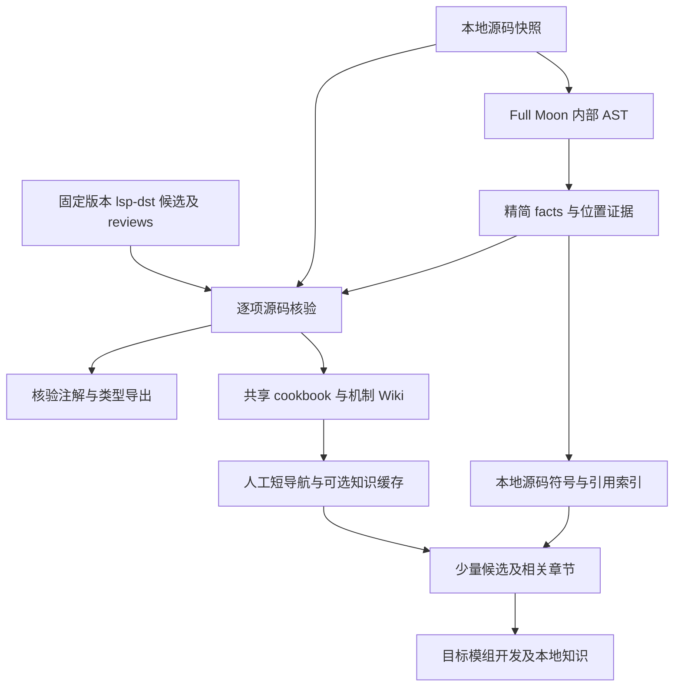

# DST Wiki 总体设计

最后更新：2026-10-27。四仓分工与存量修整已完成，固定98项组件阶段已收尾，本轮完成索引首轮重整：根导航直达原版静态直接接入量 Top 30，组件总索引按需求路由细化主题；已有知识的版本与验证范围保持原样。具体进度与认领见 [PLAN](../PLAN.md)，各包任务与设计在其自身仓库，设计依据见 [决策](decisions/index.md)，迁移验证见 [分仓验收](reports/repository-split.md)。

## 目标与使用场景

让 AI 在 DST 新增物品／装备／角色／生物／植物／建筑与修改机制时，少读无关内容、复用可靠方案，并能定向回查当前源码。自包含 Skill 可安装到不同 harness；知识资产独立维护，工具按需使用，不能把工程环境或另一 Skill 变成普通开发前置。

分仓不会直接证明 token 下降。读取范围、有限候选、停止条件与实际任务正确性共同决定效果；共享上下文的受控重放不是独立模型评测，UTF-8 输出字节不是模型 token。

## 数据分层与仓库边界

| 仓库／位置 | 职责与边界 |
|---|---|
| dst-mod-dev-skill | 目标模组开发／排查、骨架适配、机制／源码查询及模组自己的 LLM Wiki；根 SKILL.md 为可安装入口 |
| dst-wiki-skill | 共享知识的独立查询、cookbook／机制页增修、审校和索引；references／模板和轻量辅助脚本自包含 |
| dst-toolbox | Rust Full Moon、Schema、Python 工具、fixtures／回归、fork pin 和工程参考；scripts 保留现有布局 |
| dst-wiki/wiki | 唯一共享知识资产：cookbook 与 reference、短导航和追加日志 |
| dst-wiki/raw | 本地当前／历史游戏源码快照，只读、游戏源码不提交 |
| dst-wiki/output | 可重建 facts、源码索引、知识缓存与验收产物，Git 忽略 |
| 目标模组／其 Wiki | 实际代码、约定、专属骨架、差异、问题与测试，不进入通用 Skill 内容 |
| 独立 lsp-dst fork | 正式 reviews、核验 manifest、注解与覆盖记录；四仓之外的固定版本依赖 |

查询通用骨架并整合进模组、编码时查机制／源码归开发 Skill；写入共享知识归知识库 Skill。两者共享数据和路径约定但不互为前置；工程数据维护才定位工具箱。共同轻量 helper 与共享日志规则以知识库 Skill 为权威源，工具显式同步开发包的生成副本并登记哈希，安装后的包独立工作。

Schema、原字节 fixtures、Cargo.lock／工具链跟工具箱；页面格式／标签／大小唯一来源跟知识库 Skill，校验器 --format 显式消费。各仓 README／PLAN／docs/design.md 维护本仓使用、任务和实现边界，本文只保留跨仓协作与知识架构；旧混合计划 [原字节归档](history/README.md)。工程报告按主题归位，历史原文不改；知识覆盖清单与候选路线留本仓，不进入知识导航。

## 安装与路径配置

Skill 整体安装在各 harness 支持的位置，不从 .claude／.codex 层级或安装目录推算数据位置。用户级 `.dst-wiki/config.json` 存绝对 knowledge_root，toolbox_root 可选；本次明确路径优先，缺失时一次确认，不全盘扫描。配置由 Skill／工具读取，不是 harness 内建机制。第一版无项目级覆盖，不固定目标模组，同会话复用有效结果。

知识仓内部保持 wiki 与 raw 同级，已有证据相对链接仍有效；源码在 raw/current/scripts，BUILD.txt 记录真实版本与编号体系，output 为生成根。安装可只用 Wiki；明确创建空库时由知识 Skill 按需初始化最小导航，缺根索引不自动建库。只读定位返回记录版本与资源状态，指定历史快照不更新 current；这不证明安装版本或证据有效。准备脚本显式 KnowledgeRoot，更新先校验、保留旧快照并可回滚；非 Windows 可按同一结构人工准备。

工具源码输入／Wiki根／输出路径从参数或用户知识配置取得，--source-root 可指定历史快照；工作目录和四仓相邻关系不构成隐式配置。未实现跨平台自动安装、真实 harness 权限协调或目录发现服务。

## 总体架构与数据流

知识建设与日常使用分路：

箭头表示已定义数据协作，不表示整条流水线已经自动串联。完整 AST 默认不落盘，不推远程；facts、manifest、覆盖报告、索引与 resolved 是本地可重建产物，绑定版本／原字节哈希，失效或契约不兼容不能静默复用。正式 reviews 不由重提取覆盖。

解析器／工具链的版本与实际工程验收随工具箱维护；只处理所选 .lua、排除 .po。语法观察和有限 resolution 不证明运行调用图或硬依赖；类型、属性、生命周期与场景仍须核验实现／消费者及宿主，未知／冲突／截断／覆盖缺口显式保留。

## 知识组织与读取

根只放 cookbook／reference 分类和最多 30 个真实有效快捷入口；主题／叶级索引唯一登记，已知名称或章节直达。cookbook 提供必要文件、资源、加载上下文、完整最小 demo 与扩展链接；reference 下 components／prefabs／stategraphs／api／mechanisms 保存精选接口、机制案例、限制和证据，mechanisms 按实际职责分行为、UI、世界生成内部流程与数据消费等主题。首篇有效内容落地才补新分类导航；Prefab／StateGraph 的原有空索引已移除，reference 直接注明未建范围与源码回退，不引导读取占位页。modinfo 按主题聚合，不恢复任意组合 patterns、独立 pitfalls 或 sessions。

组件采用稳定正文地址 `reference/components/<组件名>.md`，按功能需求组织导航，不按物品／装备／建筑搬动跨场景复用的组件。主题索引集中在 topics/，组件总索引以人物与环境、物品与交互、战斗与生物、制作与世界四组直接路由16个主题；组名不是新增中间页。主题叶级唯一登记，组件摘要／别名与状态保持一个登记来源。旧主题的有效标题锚点保留，迁出分组给短跳转，新查询直接进入匹配主题；已知名称继续直查，不增加必读层级。具体分组、登记迁移与验收见 [主题细化](reports/w05/component-topic-refinement.md)，进度只在 PLAN 维护。Prefab 随有效内容积累组织入口，不预建完整分类树；交叉对象保留一个正文地址。

组件总索引另设原版静态直接接入量 Top 30 快捷列表，根导航可直接定位该章节。按指定快照内直接 AddComponent 字面量调用的不同文件数排序，不把它称为查询频率，也不外推公共 helper 的间接接入；未建页显示源码及缺页状态。各主题仅在父索引给短范围摘要，完整叶级登记保持唯一；榜单和主题都不是已知名称查询的前置。统计复现与首版验收见 [试用记录](reports/w05/component-top30-26148036.md)，不在每次查询或写页时重算。

2026-10-14 知识 Skill 已补 Prefab／通用机制模板和短类型指引，原组件模板保留；新建／重组只读所选模板与类型小节，普通查询和已有经验增修不默认加载。StateGraph／公共 API 用通用模板，内部机制用新增 mechanism 类型；Brain／行为、UI、世界生成和数据按入口／消费者归属，不全部塞入 API，不机械一文件一页。索引规则、两 Skill 查询与工具箱校验／筛选映射同步，未改 facts Schema、AST 或正式类型数据。代表源码／隔离草稿检视和完整任务待验收范围由 Skill PLAN／报告记录，不视为全类生成、游戏或 token 收益通过。

Prefab 是指定原版参照的入口：注册名／工厂／变体及关联机制导航列组件（含 helper／动态挂载）、Replica／同步、SG／Brain、关键 API／数据消费者、关联 Prefab 与必要资源的用途、条件和证据，链接已有具体 Wiki 章节，缺页标源码与待建。它不复制全部机制正文或递归展开依赖；造物仍优先 cookbook，明确原版对象可直达关系入口，再只读所需机制。

机制案例／问题在主要具体页维护一份，其余页链接章节。生命周期和原版参照先归接口／案例，实际协作需要整体解释才单开章节；模板保持轻量，不为批量生成增加必填内容。页面元数据是摘要，验证按所用结论／场景判断；source-reviewed／runtime-tested、页面状态和证据适用版本不能混用。具体阈值／格式只在知识库 Skill 的 write-format.md维护。

开发先确认本地约定／实现；新增未知组装选本地骨架或共享 cookbook，再按子需求补 reference，证据缺口定向读源码。局部修改或已知名称直接查机制；不是每项任务都经过全部层。每轮初始候选共用最多 5 个，必要证据充分即停止，不默认读工程资料、维护规则、日志、全部 Wiki／AST／JSON或另一 Skill。

已有 Wiki 的版本／条件／证据覆盖本题时直接复用；未覆盖结论才定向回查源码。代码遵循目标文件的注入、代理、局部绑定和加载阶段，详细说明集中在 cookbook 起步页，两个独立 Skill 只保留实际任务所需的简短检查。

可选知识查询提供词汇检索与真实章节行范围，默认总输出 16,000 UTF-8 字节；整项省略／歧义／stale可见，锚点不保证其他宿主裁剪。索引无命中不是无实现，缺工具或缓存继续 rg／Markdown。修改知识页先读原文全文，开发后的本地记录归模组，通用提炼是明确维护操作，避免自动双写。

## 建设进度与限制

通用 C48 历史检查点：337 个组件已登记、461 个候选未完成；按历史路线剩余扩展 233、专项 225、职责待确认 3。通用C46～C48补齐料理记录／节庆大餐、飞鸟吸引／生成、幸运物品／幸运来源；区分个人资料与世界缓存、进餐事件与Buff时间、自然排程与显式生成、携带装备贡献与概率公式。保留大餐查询源码疑点、废弃刷鸟空接口和实体来源自动移除的副作用边界，不推定全局随机行为或运行通过。当时按当轮用户要求确定执行规模，小批编写、定向核验和统一登记，不重复长报告；具体进度见 PLAN。结构、来源和语法通过不等于游戏运行或全库语义验收。

第七批及存量修整四阶段已完成；修正引用和验证／来源边界，精简四页重复内容并移除两张空导航，修整收尾时 62 篇知识页与 7 篇导航的结构／登记及 1,857 处源码引用检查通过。未升级游戏验证程度，不将字节精简或两条章节读取通过当作总体 token 收益；详细范围留 PLAN。通用 C01～C03 由三个子代理完成六页，另一 AI 以五组子代理接收 92 组并交付 93～110 组 43 页；主代理各自复核并合并公共文件；用户指定本对话优先高复用组件，其他 AI 处理其余且保留已开工页的所有权。公共文件写前重读、只合并本次范围，保留他方增量；该阶段登记清单共 345 篇知识页与 16 篇导航。并行缩短等待的实际程度与总 token 成本尚未测量，不因启用代理宣称省 token。attackdodger 的条件或冷却放行、电击来源需显式撤销、治疗进入绝对量累计、DPS 静默缓存和范围副效果不改战斗伤害，均按实际消费者说明。套装按头身匹配后逐件回调；伤害类别多来源与多标签可相乘，空 attacker 不查武器抗性；整次抵挡由库存提前返回，爆炸抗性在后续护甲前累计且不在该位置乘特殊伤害。通用升级先消费再回调、溢出不结转；模块装入不保证激活，PopOneModule 返回零不代表原宿主不扣电；拆卸工具只作标记，完整停止检视沿原人物／SG 入口。地雷 Explode 不内置伤害，捕捉陷阱收获可先删除宿主再发产物；撤饵只解除关联，玩家解除诅咒同时处理计数／库存／效果；诅咒物品 active 标签不构成追踪或施咒门禁。机器回调可在加载时重放，候选开关不阻止直接调用；节点不自动供电，电围栏搜索半径不限制直接连接／存档重建；标记先取消已有记录再查新增资格，代理开关会改变共享目标。旧式 Unlock 不重检类型且无成功返回，钥匙 OnUsed 未传玩家；克劳斯目标失败也可消费，真钥匙标记会通知世界；拆表实际先发材料再删除目标，与其注释相反。前批边界继续保留：SetHome 不等于巢穴登记，GOHOME 接收可移除子体，容量设置会重算巢内储备，完整生物行为仍需实际宿主协作。位置记录不提供自动移动，单体进屋保留实体但宿主可重置属性，周期产物返回 true 不保证生成实体且停用状态未单独保存。群体阈值不阻止所有直接登记，SetHerd 不替代集合登记，Leave 会在启用时再排建群，禁用例在重连后处理；自动合并后的多方引用一致性仍待游戏核验。mood 的重配／校准可能改状态或重复回调，禁用不等于暂停扣天，保存倍率不决定扣天速度；原宿主的启停／成员表现保持单一协作链。驯化自然增长可能绕过公开方法包装，上下骑是动作／SG／双向状态协作；卸鞍标记本身无业务方法，拴柱锁只影响部分候选，空存读不表示关系会自动重连。装扮准入开关不关闭已有用户，舔盐暂停停止当前轮计时；刷毛产量实际读取 cyclesperprize，直接调用的条件表达式不等同标签门禁；shaveable 不自动扣奖品，beard 回调可在存读／换肤时重放，牛皮肤清单／授权／显示刷新与宿主恢复分别核验。宠物两套限额分别计数，解除登记不自动撤销跟随／独立保存；宠物血条只显示、没有通用 nil 解绑，最近驯养参与者不是所有权。性格积分、动画完成、主导锁定分开；巢装饰直接工具消费、周期续 Buff 与退出时机分别核验。激活动作的 nil 兼容不等于成功事件；物品候选筛选不代替执行校验，停止状态不自动撤销宿主效果；建筑交互的关闭准入、SG 中止和停止回调分别处理，多人模式切换保留实现限制。显示页仍不承担施肥／精确值同步／完整视野能力，数据修改归 farming_manager；已建产物累积／再生例保留宿主与世界门禁，旧农场页不恢复制作配方，也不推荐替代现代农田。制作配方注册 API 仍是配方／建筑骨架的实际缺口，料理注册 API 也尚未成页，不把组件覆盖当完整注册教程。heatrock 仍为首篇正式 Prefab 关系入口候选；之后补配方所需注册 API 与场景骨架，建筑随必要机制推进。后续组件队列继续保留，真实任务依赖可提前插入；这些后续项是待执行计划，不代表已发布新页或取得查询收益。

W01–W04 的工具／类型试点和 W05 检索工具的详细验收归工具箱；lsp-dst 仅 finiteuses／equippable 有正式逐项修订，其余声明仍是候选，不称整库当前准确。共享知识已有五篇 cookbook 与组件／modinfo 页，保留各自证据边界；游戏运行和独立模型完整 token 收益未验证。知识／任务检视留本仓。

工具箱当前功能足够，暂时冻结功能演进，仅处理真实阻塞和必要同步。新源码影响分析、自动失效提示与语义迁移仍未实现，当前用既有哈希检查／人工复查。Skill 文件及 helper 的异地调用只验证分发独立性；实际 harness 的发现、目录权限与自主路由另行验收。

组件建设新增一个阶段检查点：先完成 C28 后冻结的 98 项通用扩展候选，再提醒用户，优先重整根／分类／主题导航，完成后恢复其余扩库；页面深度随真实职责决定。固定范围、进度与触发条件只在 PLAN 及其链接清单维护，不以全库组件总数判定，也不改成日常查询的必读内容。

## 当前建设顺序：先完善知识库 Skill

先验证独立安装与首次定位，再验证查询／源码兜底、单页与小批生成、案例／陷阱／骨架增修和知识检查，最后在实际 harness 中检验自主路由与读取成本。规则、必要模板和轻量脚本随 Skill 提供，知识／源码是外部输入；基础生成可直接核验源码并写 Markdown，facts／类型线索与批量校验属于可选增强，不将完整 AST 流水线作为使用前置。

“可用”以代表任务能完成、依据及缺口可追溯、无可选工具时仍能执行支持的流程为准。一个主要实际宿主完成安装／外部定位、已覆盖查询、缺页回退和隔离维护即可进入单页实战；不等待全部 harness、写入任务矩阵或总体 token 收益。安装后的 Skill 先试建 moisture，检视后完成 moistureimmunity／freezable，再恢复小批扩库；发现真实共性缺口则窄修规则／模板，只声明实际验证过的支持范围。

读取成本与正确性随建设持续评测，分别记录已有覆盖、部分覆盖和完全缺页任务。已有知识验证复用收益，部分覆盖检验缺口补查，缺页检验定向回退与停止；不把内容缺失当流程失败，不把源码回退成功当知识充分覆盖。基础可用性、内容覆盖、游戏运行与总体收益分别报告，建设成本另计。

2026-10-16 人工 review 后恢复独立任务：已有覆盖查询可直接复用 Wiki，缺页回退与临时局部维护样本可用；moisture 经独立试建、源码审阅与结构／语法检查后入库，未运行游戏。全部非组件任务、其他平台／harness 与缺页回退成本持续检视，不作为当前组件扩库前置；具体读取度量与证据在 Skill 报告维护。

详细工作项仅在 dst-wiki-skill/PLAN.md 维护，知识仓保留覆盖与原批次队列。读取成本记录实际文件／章节、源码范围和重复回退，可取得准确 token 时才报告 token，否则明确使用字节／字符代理；页面数量、分仓和规则压缩不能单独证明智能程度或 token 收益。

## 文档与版本维护

写页校验由 Skill 的 verify-wiki 保留轻量选择表、常用命令与结果判断；工具参数、输出与 record 行为唯一归工具箱的具体说明，不再随每次写页加载完整手册。facts／类型／LSP 等校验独立为 verify-engineering，仅命中工程任务时读取；工具箱可选，不改变普通查询与 Markdown 维护的使用条件。

普通查询使用现有知识及必要源码，不自动检查游戏是否更新，也不进行版本／哈希对比或写哈希检查缓存；版本跟进由用户主动发起维护。页内版本保留为证据范围，已知冲突和内容缺口仍按查询规则定向处理，不因此触发全库健康检查。

README 介绍知识资产，PLAN 只维护内容建设／检视／复查，本文随跨仓职责／数据流／兼容边界变化同步。各 Skill 和工具箱维护自己的 README、PLAN 与包设计；不由本仓重复逐项状态或执行规范。decisions 保留理由，reports／history 保存历史范围。日志在 wiki/log.md 追加，超限整卷原样移入 wiki/log-archive/ 并由当前卷链接上一卷；历史不改写，日志及归档不进入知识候选。阈值与操作规则仅在知识库 Skill 的 references/maintain/maintain-log.md 维护，实际写入时条件加载，平时只取计数及必要尾部，追溯再定位旧条目；日常查询与局部知识维护不加载工程设计。

共享知识 Skill 已扩充现成模组经验提炼规则并新增版本增量维护 reference，SKILL.md 用 7 条路由按需加载；空库初始化单列，直达 first-use 的建库小节，生成技术内容再进入 Ingest。references 按 setup／query／maintain 归类，模组分析和骨架写入分文件，入口直达且不增目录索引；详细工作只在其 PLAN。规则已编写，专项任务效果待检视。通用组装归 cookbook、机制归 reference、专属经验归模组；版本维护由源码 BUILD.txt 对照页面 dst_build／状态筛范围，再比较对应旧／新快照、必要消费者和骨架引用。模组 Git 差异与 Wiki 历史各有用途，游戏源码无需提交；同版本仍处理落后页面和用户指定增补，不因 build 变化批量升级核验版本。普通查询不加载这两条维护流程，工具箱保持冻结，基础局部维护样本不等于两条专项流程已验收。

原创内容采用 CC BY-SA 4.0，游戏／第三方代码保留原授权；源码／产物／个人配置不提交。独立 fork 保留其 MIT-0。四仓本地迁移不等于创建远程或发布 release，未经请求不提交／推送。

版本维护先复用 wiki/updates 中匹配起止快照的已核验增量条目，缺口才定向读 diff；修补得到的新条件和纠错同批回写，避免不同页面重复研究共享变化。updates 记录版本差异与用法条件，reference 维护当前机制，output 保存机械映射与可重建检查结果；局部修补不强制先生成全量报告。

版本维护按任务量加载：单页只读 Skill 的 maintain-version，明确 2 页及以上或整类／全库才追加 maintain-version-batch 的三类沿用和批次收尾。工具箱负责相同区间定位、上下文及页面格式限制，报告／共享 diff 与必要关联筛查负责行为边界；单页也可使用定位工具，无须先读批量协议。Skill 保持升版／验证边界，工具箱维护实现与测试，本仓 PLAN 记录页面进度；不增加 AST、完整依赖分析或游戏运行验证。
